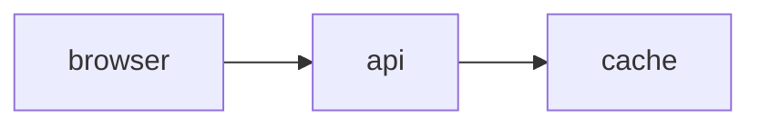

# portfolio-yazi

[](https://astro.build)
[](https://nodejs.org)
[](LICENSE)

A portfolio theme for [Astro](https://astro.build) that looks and behaves like the terminal file
manager [Yazi](https://github.com/sxyazi/yazi): three panes, a status line, keyboard navigation —
and every page is still a plain, crawlable HTML document.

Free and open source (MIT). Static output, no client-side framework, no external requests by
default.


| Project page with cover image and diagram | Mermaid examples rendered at build time |
| --- | --- |
|  |  |

## Features

- **File-manager layout** — parent directory, current directory and a live preview of the selected
  entry, in Yazi's 1 : 4 : 3 ratio. Collapses to two columns, then one, on small screens.
- **Keyboard first** — arrow keys or `h j k l`, `Enter` to open, `?` for all shortcuts. The
  selection lives in the URL (`#sel=name`), so every state is a shareable link.
- **Works without JavaScript** — entries are real links, previews are server-rendered. The script
  is a small progressive enhancement, no UI framework.
- **Content collections** — projects, blog posts, pictures, legal pages and diagram examples are
  Markdown (or `.mmd`) files with validated frontmatter.
- **File-type icons** — inline SVG glyphs (Material Icon Theme data) recoloured from the flavor
  variables, like Yazi's `[filetype]` rules; the selected folder shows its open state.
- **Blog RSS feed** — every post ships in `~/blog/feed.xml`; the feed file appears in the
  directory listing itself.
- **SEO ready** — canonical URLs, Open Graph and Twitter cards on every page, plus a sitemap
  (legal pages excluded, they render `noindex`).
- **Images** — a `pictures/` folder with previews, plus optional cover images, optimised through
  `astro:assets`.
- **Mermaid diagrams at build time** — fenced `mermaid` blocks become inline SVG in the theme
  colours. No client-side library, no third-party requests.
- **One swappable flavor** — all colours are CSS variables in a single block. Ships with a neon
  "sweet" palette inspired by the Garuda Linux Dr460nized look; glass and glow effects live in one
  optional stylesheet.
- **Accessible** — labelled panes, visible focus, `prefers-reduced-motion` and
  `prefers-reduced-transparency` respected, native `<dialog>` for the shortcut overlay.
- **No cookies, self-hosted font** — zero external requests by default, optional
  privacy-friendly SimpleAnalytics toggle, plus imprint and privacy templates.

## Quick start

Requires **Astro 7** and **Node.js 26 or newer** (`engines` + `engine-strict` enforce this on
`npm install`; the tests rely on Node's built-in TypeScript support). All dependencies are public
npm packages — no private registries, no build-time secrets.

```bash
git clone https://github.com/nkoeberlein/portfolio-yazi.git my-portfolio
cd my-portfolio
npm install
npm run dev        # http://localhost:4321
```

| Command | What it does |
| --- | --- |
| `npm run dev` | Dev server with hot reload |
| `npm run build` | Static build into `dist/` |
| `npm run preview` | Serve the built site locally |
| `npm run check` | Type-check `.astro` and `.ts` files |
| `npm test` | Unit tests for the pure modules in `src/lib/` |
| `npm run lint` / `npm run format` | Biome: check / fix formatting and lint rules |

## Make it yours

The theme ships with sample content for a fictional engineer, Max Mustermann. Replace it in this
order:

1. **`src/site.config.ts`** — `url`, name, role, location, contact channels, stack, optional
   analytics (`simpleAnalytics: false` by default), and the `user@host` handle. Feeds sitemap,
   canonical/OG URLs and the RSS feed, the profile on the home screen, the breadcrumb, page
   titles and the shell prompt.
2. **`src/lib/tree.ts`** — the entries of the home directory `~/`: which folders and files exist,
   in which order.
3. **`src/content/`** — your actual content:

   | Folder | One file per | Required frontmatter |
   | --- | --- | --- |
   | `projects/` | project | `title`, `summary`, `period`, `role`, `updated` |
   | `blog/` | post | `title`, `summary`, `published` |
   | `pictures/` | image | `title`, `alt`, `caption`, `taken`, `image` |
   | `diagrams/` | `.mmd` diagram | `%% title`, `%% summary`, `%% updated` header lines |
   | `legal/` | page | `title`, `summary`, `updated` |

   Projects and posts accept an optional `cover` image and `coverAlt`.
4. **`src/pages/*.astro`** — the single-file pages (`about`, `now`, `cv`, `skills`, `contact`,
   `welcome`) are written directly as Astro pages.
5. **`src/assets/`** — replace the generated placeholder SVGs with your own images.
6. **`src/content/legal/`** — the imprint and privacy texts are templates with `TODO` markers.
   Fill in real details and have them checked before you publish; they are not legal advice.

### Change the colours

Edit the `:root` block in `src/styles/global.css`. Every component reads those variables, so a
different palette is a dozen lines. To turn off the neon background, blur and glow, remove the
`fx.css` import in `src/layouts/TUIShell.astro`.

### Add a diagram

Use a fenced code block with the language `mermaid` in any Markdown file:

````md

````

Supported: flowchart, sequence, class, ER, state and XY chart. Other types (gantt, pie, mindmap,
gitGraph) fail the build with a clear message. `src/content/diagrams/` has one example per type.

## Keyboard

| Key | Action |
| --- | --- |
| `↑` `↓` or `k` `j` | Move the selection |
| `→`, `Enter` or `l` | Open the selected entry |
| `←` or `h` | Go to the parent directory |
| `Home` `End` or `g` `G` | First / last entry |
| `J` `K` | Scroll the preview pane |
| `q` | Back to `~` |
| `?` | Show all shortcuts |

## Project structure

```
src/
  site.config.ts     who the site is about
  content.config.ts  collection schemas
  content/           projects, blog, pictures, diagrams, legal
  assets/            images processed by astro:assets
  pages/             one route per file-manager entry
  layouts/           TUIShell.astro — header, panes, status line
  components/        the three panes and the shortcut overlay
  lib/               view-models, preview HTML, Mermaid plugin (+ tests)
  scripts/keynav.ts  keyboard navigation
  styles/            flavor variables, layout, effects
```

## Deploying

`npm run build` produces a plain static site in `dist/` — it runs on any static host. Set
`url` in `src/site.config.ts` to your domain: it drives the sitemap, canonical URLs, Open Graph
tags and the RSS feed. Add your own `public/og.png` (1200 × 630) for social link previews.

## Credits

- Interaction model and layout: [Yazi](https://github.com/sxyazi/yazi) by sxyazi.
- Colour palette: inspired by the [Sweet](https://github.com/EliverLara/Sweet) theme as used in
  Garuda Linux Dr460nized. This project is not affiliated with Yazi, Sweet, Garuda Linux or Astro.
- Font: [JetBrains Mono](https://www.jetbrains.com/lp/mono/), SIL Open Font License 1.1
  (`public/fonts/OFL.txt`).
- Diagrams: [beautiful-mermaid](https://github.com/lukilabs/beautiful-mermaid).

## License

[MIT](LICENSE) © 2026 Nikolaus Köberlein. Code and sample content are yours to use and change.
Questions or problems? [Open an issue](https://github.com/nkoeberlein/portfolio-yazi/issues).

Not covered by that license: the JetBrains Mono font files (SIL Open Font License 1.1) and the
Astro logo, which is a trademark of its owner and appears here only to say "built with Astro".
